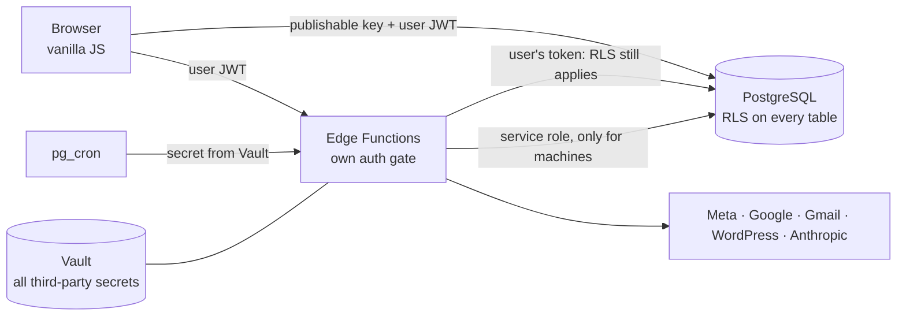

# MERP — an ERP for marketing agencies

MERP is the operating system of [Simba Marketing](https://simbamarketing.nl), a Dutch performance-marketing agency. It started as a CRM and grew into one place for the whole commercial side of the agency: sales pipeline and quotes, client management, campaign analytics, a client portal. The operational side is also in development: HR, finance and bookkeeping. A set of automated agents keep an eye on it all.

The end goal is a product other agencies can use, where a use-case still is t be found. Howver, that goal shapes how it is built today, even though most of it still serves one agency, the infrastructure is set up in a scalable way.

> **Built with generative AI.** MERP is written by one person working with [Claude Code](https://claude.com/claude-code) (Anthropic) as an AI pair programmer, supported by a small team of AI agents for security review, backlog and reporting. The product decisions, the architecture and the security model are mine; the AI writes most of the code under that direction. Every change is reviewed, tested and, for anything touching access control, attacked before it ships. How that works in practice is described in [docs/working-with-ai.md](docs/working-with-ai.md).

This repository is a **curated showcase**, not the production codebase. It contains a selection of self-contained modules with their tests, plus the design and security principles behind the whole system. Client data, credentials and the code of live endpoints are deliberately left out.

> The code and its comments are in Dutch: the product is built for Dutch agencies, by a Dutch team. This README and the docs are in English.

---

## What it does

| Area | What's in it |
|---|---|
| **Sales** | Pipeline, quotes with options and e-signing, follow-ups, a shared team inbox on top of Gmail |
| **Client management** | One page per client: analytics, leads, planning, files, production days, activity timeline |
| **Client portal** | Clients log in to see their own leads, campaign results, reports and content planning, and can edit what's theirs to edit |
| **Analytics** | Meta, Google, Klaviyo, Shopify, WooCommerce and Instagram synced daily; plan-versus-actual per campaign; MER for e-commerce clients |
| **Leads** | Website forms, Meta lead forms and lead emails all land in one table, are placed on a map of the Netherlands and grouped by province |
| **Finance** | Double-entry bookkeeping in its own schema: chart of accounts, journals, sales invoices, purchase receipts read by a model |
| **SEO** | Keyword research, topic clustering and a daily draft that a human approves before it goes to WordPress |
| **Agents** | Monthly security audit, backlog proposals, subsidy watch, lead-feed watchdog — each one emails a human, none acts on its own |

## Stack

Deliberately small:

- **Frontend:** vanilla JavaScript, HTML and CSS. No framework, no build step.
- **Backend:** Supabase — PostgreSQL with Row Level Security, Auth, Storage, Edge Functions (Deno) and `pg_cron`.
- **Hosting:** static files behind nginx on a VPS.
- **AI:** Claude (Anthropic) and OpenAI models, always behind a server-side function, never with a key in the browser.



## The idea that holds it together

**The database is the only boundary.** The publishable key ships with every page, so anyone can query the database without the frontend. A filter in JavaScript decides what a user *sees*, never what they *can fetch*. Every table therefore carries its own rules, written as two layers of Row Level Security, and every rule is tested by attacking it — not by reading it.

That principle, and the patterns that follow from it, are written down in [docs/security-model.md](docs/security-model.md).

## What's in this repository

```
frontend/
  design-system.css      Tokens and components shared by staff and client pages
  offertetaal.js         Quote logic: two languages, options, commission lines, VAT
  campagneplan.js        Campaign plan: the funnel calculated from its assumptions
  campagnevergelijk.js   Plan versus actual, per campaign
  leadkaart.js           Canvas map of the Netherlands with zoom, pan and lead clusters
  nl-kaart.js            Province outlines (CBS open data)
sql/
  rls-patterns.sql       The access-control patterns, as a runnable example
tests/                   The real tests for the modules above
docs/
  security-model.md      Principles, the two-layer RLS model, forbidden patterns
  working-with-ai.md     How the system is built and watched with Claude and a team of agents
```

### A few things worth looking at

- **[offertetaal.js](frontend/offertetaal.js)** — one place where a quote line becomes an amount. It replaced six copies of `qty * unit_price` spread over the form, the PDF and the public signing page. The database recalculates the same amount on signing, so the browser never decides what someone signs for.
- **[campagneplan.js](frontend/campagneplan.js)** — a plan with a missing assumption shows a dash, not an invented default. A plan that looks complete but rests on a made-up number is worse than a plan with gaps.
- **[leadkaart.js](frontend/leadkaart.js)** — Web Mercator, zoom towards the cursor, cluster radius by square root so area follows count. The test drives the full draw loop against a proxy canvas.

## Running the tests

Requires Node 18 or later. No dependencies.

```bash
npm test
```

## Screenshots

See [docs/screenshots](docs/screenshots/) — all taken with demo data.

## License

All rights reserved. This code is published to show how the system is built; it is not licensed for reuse.
